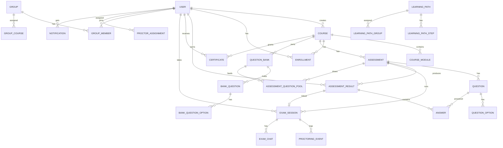
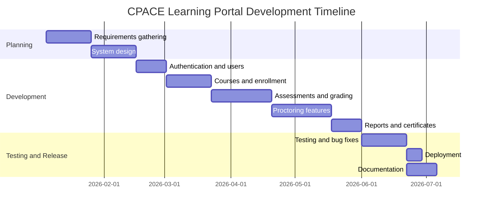

# APPENDICES

**CPACE Learning Portal: A Web-Based Learning, Assessment, and Online Proctoring System**

> Items marked `[PLACEHOLDER]` need your own details (names, dates, signatures, screenshots). Everything else is drawn from the project's source code and documentation.

---

## List of Appendices

| Appendix | Title |
| --- | --- |
| A | Communication Letters |
| B | Survey Questionnaire (System Evaluation) |
| C | System Requirements |
| D | User Roles and Access Matrix |
| E | Database Schema (Entity Descriptions) |
| F | Entity Relationship Diagram |
| G | Application Pages and API Endpoints |
| H | System Screenshots |
| I | Test Cases and Results |
| J | Installation and Deployment Guide |
| K | User Manual |
| L | Sample Source Code |
| M | Project Timeline (Gantt Chart) |
| N | Curriculum Vitae of the Researchers |

---

## Appendix A: Communication Letters

### A.1 Request Letter to Conduct the Study

```
[DATE]

[NAME OF RECIPIENT]
[POSITION]
CPACE
[ADDRESS]

Dear Sir/Madam:

Greetings!

We, the undersigned [PROGRAM/YEAR] students of [SCHOOL], are currently
developing our capstone project entitled "CPACE Learning Portal: A Web-Based
Learning, Assessment, and Online Proctoring System."

In connection with this, we respectfully request permission to gather data,
conduct interviews, and test the system with your staff and learners. All
information gathered will be treated with strict confidentiality and used
solely for academic purposes.

Thank you for your kind consideration.

Respectfully yours,

[NAME]                [NAME]                [NAME]
Researcher            Researcher            Researcher

Noted by:   [ADVISER NAME], Capstone Adviser
Approved by: [CLIENT / AUTHORIZED REPRESENTATIVE]
```

### A.2 Letter of Acceptance / Approval
`[PLACEHOLDER: attach signed approval letter from CPACE]`

### A.3 Informed Consent Form (Respondents)

```
I, ____________________, voluntarily agree to participate in the evaluation of
the CPACE Learning Portal. I understand that my responses will remain
confidential, that I may withdraw at any time, and that data will be used only
for academic research in accordance with the Data Privacy Act of 2012 (RA 10173).

Signature: ____________________    Date: ____________
```

---

## Appendix B: Survey Questionnaire (System Evaluation)

**Part I. Respondent Profile**

| Item | Response |
| --- | --- |
| Name (optional) | |
| Role | ☐ Administrator ☐ Instructor ☐ Proctor ☐ Learner |
| Age | |
| Experience with online learning platforms | ☐ None ☐ Some ☐ Extensive |

**Part II. Evaluation** — Rate each statement:
**5** Strongly Agree · **4** Agree · **3** Neutral · **2** Disagree · **1** Strongly Disagree

*Functionality*

| # | Statement | 5 | 4 | 3 | 2 | 1 |
| --- | --- | --- | --- | --- | --- | --- |
| 1 | Registration and login work correctly. | | | | | |
| 2 | Courses and modules can be accessed and tracked properly. | | | | | |
| 3 | Learners can enroll in courses and view progress. | | | | | |
| 4 | Assessments (quiz, practice, final exam) function as expected. | | | | | |
| 5 | Scores are computed accurately and promptly. | | | | | |
| 6 | Certificates are issued correctly after passing the final exam. | | | | | |
| 7 | The proctoring features (camera, identity check, flagging) work as intended. | | | | | |
| 8 | Reports and CSV exports provide useful information. | | | | | |

*Usability*

| # | Statement | 5 | 4 | 3 | 2 | 1 |
| --- | --- | --- | --- | --- | --- | --- |
| 9 | The system is easy to learn and use. | | | | | |
| 10 | Navigation and menus are clear. | | | | | |
| 11 | The interface is visually appealing and consistent. | | | | | |
| 12 | The system is usable on mobile devices. | | | | | |

*Reliability and Performance*

| # | Statement | 5 | 4 | 3 | 2 | 1 |
| --- | --- | --- | --- | --- | --- | --- |
| 13 | Pages load quickly. | | | | | |
| 14 | The system recovers my exam answers after a refresh or disconnection. | | | | | |
| 15 | The system runs without errors during use. | | | | | |

*Security*

| # | Statement | 5 | 4 | 3 | 2 | 1 |
| --- | --- | --- | --- | --- | --- | --- |
| 16 | My account and personal data are protected. | | | | | |
| 17 | Users can only access features allowed for their role. | | | | | |
| 18 | The proctoring consent notice is clear and understandable. | | | | | |

**Part III. Open-Ended**
1. What features did you like most?
2. What features need improvement?
3. Additional comments or suggestions:

**Interpretation Scale**

| Mean Range | Verbal Interpretation |
| --- | --- |
| 4.21 – 5.00 | Strongly Agree (Excellent) |
| 3.41 – 4.20 | Agree (Very Good) |
| 2.61 – 3.40 | Neutral (Good) |
| 1.81 – 2.60 | Disagree (Fair) |
| 1.00 – 1.80 | Strongly Disagree (Poor) |

---

## Appendix C: System Requirements

### C.1 Software (Development)

| Tool | Purpose |
| --- | --- |
| Next.js 16 (App Router) | Full-stack framework: UI and REST API routes |
| TypeScript | Static typing across the codebase |
| React | Component-based UI |
| Tailwind CSS | Utility-first styling |
| shadcn/ui (Radix UI) | Accessible UI components |
| Prisma ORM | Type-safe database access and schema management |
| Supabase (PostgreSQL) | Cloud-hosted database |
| NextAuth.js | Authentication (credentials, JWT sessions) |
| bcrypt | Password hashing |
| Zod | Request validation |
| Vitest | Automated testing |
| Visual Studio Code | Code editor |
| Git / GitHub | Version control |
| Vercel | Deployment platform |

### C.2 Hardware / Client Requirements

| Component | Minimum |
| --- | --- |
| Device | Desktop, laptop, tablet, or smartphone |
| Browser | Current Chrome, Edge, Firefox, or Safari |
| Camera | Required for proctored exams (final exams) |
| Internet | Stable broadband connection |
| Development machine | Node.js 18+, npm, 8 GB RAM recommended |

---

## Appendix D: User Roles and Access Matrix

| Feature | Admin | Instructor | Proctor | Learner |
| --- | :---: | :---: | :---: | :---: |
| Register / Login | ✔ | ✔ | ✔ | ✔ |
| Manage users and roles | ✔ | | | |
| Pre-approved email whitelist | ✔ | | | |
| Create/manage courses | ✔ | ✔ (own) | | |
| Manage question banks / assessments | ✔ | ✔ (own) | | |
| Manage groups and learning paths | ✔ | ✔ | | |
| Enroll in courses | | | | ✔ |
| Take assessments | | | | ✔ |
| Manual grading queue | ✔ | ✔ (own) | | |
| Monitor live exam sessions | ✔ | | ✔ (assigned scope) | |
| Review proctoring events / chat | ✔ | | ✔ | |
| View reports and CSV exports | ✔ | ✔ (own) | | |
| View certificates | ✔ | ✔ | | ✔ |
| Audit log | ✔ | | | |
| Manage homepage content (events, FAQs, articles) | ✔ | | | |

---

## Appendix E: Database Schema (Entity Descriptions)

The database is PostgreSQL (Supabase) managed through Prisma (`prisma/schema.prisma`).

### E.1 Core Learning Entities

| Table | Key Fields | Description |
| --- | --- | --- |
| `users` | id, email, password, firstName, lastName, role, isActive, activeSessionToken | System accounts; roles: ADMIN, INSTRUCTOR, PROCTOR, LEARNER |
| `courses` | id, title, category, level, duration, price, status, creatorId, instructorId | Courses (DRAFT / PUBLISHED / ARCHIVED) |
| `course_modules` | id, title, content, videoUrl, duration, order, isPublished, courseId | Lessons within a course |
| `enrollments` | userId, courseId, progress, status, completedModules | Learner enrollment and progress (unique per user + course) |
| `groups` | id, name, description, creatorId | Learner cohorts |
| `group_members` | groupId, userId | Cohort membership |
| `group_courses` | groupId, courseId | Courses assigned to a cohort |
| `learning_paths` | id, title, isPublished, creatorId | Ordered learning sequences |
| `learning_path_steps` | pathId, type (COURSE/ASSESSMENT), order, isRequired | Steps in a path |
| `learning_path_groups` | pathId, groupId | Paths assigned to cohorts |
| `certificates` | certificateNumber, userId, courseId, issuedAt, isValid | Issued upon passing the final exam |

### E.2 Assessment Entities

| Table | Key Fields | Description |
| --- | --- | --- |
| `assessments` | type, timeLimit, attempts, passingScore, startsAt, endsAt, releaseScores, detection settings | Reviewer, Practice, Rules & Guidelines, Final, Quiz, Assignment, Survey |
| `questions` | question, type, points, order, assessmentId | MULTIPLE_CHOICE, TRUE_FALSE, SHORT_ANSWER, ESSAY |
| `question_options` | text, isCorrect, order | Choices for a question |
| `assessment_results` | score, passed, attempt, startedAt, completedAt, gradedAt, gradedById | A learner's attempt |
| `answers` | content, isCorrect, points, feedback | Individual answers |
| `question_banks` | title, code, courseId, isArchived | Reusable question repositories |
| `bank_questions` | difficulty, topic, tags, timesUsed, timesCorrect | Bank items |
| `bank_question_options` | text, isCorrect | Bank item choices |
| `assessment_question_pools` | assessmentId, bankId, drawCount, difficulty, topic | Random draw configuration |

### E.3 Proctoring Entities

| Table | Key Fields | Description |
| --- | --- | --- |
| `exam_sessions` | status, startedAt, deadlineAt, identityPhoto, idPhoto, consentAt, lastHeartbeatAt, draftAnswers, draftVersion, flagged | Live exam attempt |
| `proctoring_events` | type, severity, evidenceSnapshot, reviewStatus, reviewNotes | Detected incidents and reviews |
| `exam_chats` | message, senderId, sessionId, isRead | Proctor–learner chat |
| `webrtc_signals` | sessionId, senderId, type, payload | WebRTC negotiation messages |
| `proctor_assignments` | proctorId, courseId, groupId, scopeKey | Proctor scope of monitoring |

### E.4 Supporting Entities

| Table | Description |
| --- | --- |
| `password_reset_tokens` | Forgot-password tokens with expiry |
| `pre_approved_emails` | Email whitelist for registration |
| `notifications` | In-app notifications |
| `audit_logs` | Staff actions and exam-security events |
| `articles`, `article_comments` | Public news/insights and comments |
| `training_events`, `homepage_faqs` | Public landing-page content |

---

## Appendix F: Entity Relationship Diagram



---

## Appendix G: Application Pages and API Endpoints

### G.1 Dashboard Pages

| Route | Description |
| --- | --- |
| `/` | Public landing page |
| `/login`, `/register` | Authentication |
| `/about`, `/services`, `/insights`, `/privacy`, `/cookies` | Public information pages |
| `/dashboard` | Role-based home dashboard |
| `/dashboard/courses` | Course management and enrollment |
| `/dashboard/assessments` | Assessments grouped by program |
| `/dashboard/assessments/[id]/manage` | Question management |
| `/dashboard/assessments/[id]/take` | Exam taking |
| `/dashboard/question-banks` | Test bank management |
| `/dashboard/grading` | Manual grading queue |
| `/dashboard/groups` | Cohort management |
| `/dashboard/learning-paths` | Learning paths |
| `/dashboard/proctor` | Live proctor monitoring |
| `/dashboard/certificates` | Certificates |
| `/dashboard/reports` | Analytics and CSV exports |
| `/dashboard/schedules`, `/dashboard/calendar` | Exam and training schedules |
| `/dashboard/users` | User management (admin) |
| `/dashboard/audit` | Audit log (admin) |
| `/dashboard/content`, `/dashboard/faqs`, `/dashboard/insights` | Homepage content management |
| `/dashboard/settings` | Profile and password |

### G.2 Representative API Endpoints

| Method | Endpoint | Description |
| --- | --- | --- |
| POST | `/api/auth/register` | Register a new user |
| GET/PATCH | `/api/users/me` | Own profile and password |
| GET/PATCH | `/api/users` | User administration |
| GET/POST | `/api/courses` | List/create courses |
| GET/POST | `/api/assessments` | List/create assessments |
| GET/POST | `/api/assessments/[id]/questions` | List/add questions |
| DELETE | `/api/assessments/[id]/questions/[qid]` | Delete a question |
| POST | `/api/assessments/[id]/submit` | Submit answers |
| GET/POST | `/api/banks`, `/api/banks/[id]`, `/api/banks/[id]/questions` | Question banks |
| GET/POST/DELETE | `/api/enrollments` | Enrollment management |
| GET | `/api/certificates` | Certificates |
| GET | `/api/dashboard/stats` | Dashboard statistics |

All list endpoints support `?page=1&limit=20` and return `{ data, total, page, limit, totalPages }`.

---

## Appendix H: System Screenshots

`[PLACEHOLDER: insert screenshots, one per figure]`

| Figure | Screen |
| --- | --- |
| H.1 | Landing page |
| H.2 | Login page |
| H.3 | Registration page |
| H.4 | Admin dashboard |
| H.5 | Course management |
| H.6 | Question bank management |
| H.7 | Assessment setup and proctoring settings |
| H.8 | Learner exam interface with timer |
| H.9 | Identity verification and consent |
| H.10 | Proctor live monitoring view |
| H.11 | Manual grading queue |
| H.12 | Reports and CSV export |
| H.13 | Certificate view |
| H.14 | User management |
| H.15 | Mobile view (390px) |

---

## Appendix I: Test Cases and Results

### I.1 Automated Testing Summary
Automated tests (Vitest): **261 tests in 31 files**, with TypeScript checks and a successful production build. Commands: `npm run check:portal`, `npm run check:portal:data`, `npm run check:portal:runtime`.

| Area | Evidence |
| --- | --- |
| Role access | Admin, instructor, learner, proctor route tests |
| Learning paths | Prerequisites, completion, progress ownership |
| Assessment recovery | Versioned drafts, resume timer, idempotent submission |
| Proctor workflow | Scope isolation, review and chat boundaries |
| Reporting | Date/CSV helpers, role scope |
| Session expiry | Suspended users, replaced sessions |
| Mobile navigation | Four roles at 390px |
| Manual grading | Ownership, bounds, finalized results, certificates |
| Exam integrity | Late-answer injection, immutable banks, deadline enforcement |

### I.2 Functional Test Cases (Black-Box)

| ID | Test Case | Steps | Expected Result | Actual | Status |
| --- | --- | --- | --- | --- | --- |
| TC-01 | Register valid user | Fill the form with a valid, approved email | Account created, redirected to login | `[ ]` | `[ ]` |
| TC-02 | Register invalid input | Submit with a short password | Validation error shown | `[ ]` | `[ ]` |
| TC-03 | Login valid | Enter correct credentials | Dashboard opens for the role | `[ ]` | `[ ]` |
| TC-04 | Login invalid | Enter a wrong password | Error message, no access | `[ ]` | `[ ]` |
| TC-05 | Role guard | Learner opens `/dashboard/users` | Access denied | `[ ]` | `[ ]` |
| TC-06 | Create course | Instructor submits the course form | Course appears as DRAFT | `[ ]` | `[ ]` |
| TC-07 | Enroll in course | Learner enrolls | Enrollment ACTIVE, progress 0% | `[ ]` | `[ ]` |
| TC-08 | Add question | Add a multiple-choice question | Question saved and listed | `[ ]` | `[ ]` |
| TC-09 | Take timed exam | Start exam, answer questions | Timer runs, answers autosaved | `[ ]` | `[ ]` |
| TC-10 | Refresh during exam | Reload the page mid-exam | Answers and timer restored | `[ ]` | `[ ]` |
| TC-11 | Submit exam | Submit all answers | Score computed, pass/fail shown | `[ ]` | `[ ]` |
| TC-12 | Certificate issuance | Pass the final exam | Certificate generated | `[ ]` | `[ ]` |
| TC-13 | Manual grading | Grade an essay answer | Final score updated | `[ ]` | `[ ]` |
| TC-14 | Proctor flagging | Trigger a detector event | Event listed to the proctor | `[ ]` | `[ ]` |
| TC-15 | Proctor chat | Proctor sends a message | Learner receives it | `[ ]` | `[ ]` |
| TC-16 | Deadline enforcement | Save after the deadline | Save rejected | `[ ]` | `[ ]` |
| TC-17 | Report export | Download CSV | File matches role scope | `[ ]` | `[ ]` |
| TC-18 | Session replacement | Log in from another browser | Old session invalidated | `[ ]` | `[ ]` |
| TC-19 | Password reset | Request a reset link | Token sent, new password works | `[ ]` | `[ ]` |
| TC-20 | Mobile layout | Open at 390px | Drawer navigation, no clipped controls | `[ ]` | `[ ]` |

`[PLACEHOLDER: fill Actual and Status (Pass/Fail) after your test run]`

### I.3 Pending Real-World Acceptance
Per `docs/PORTAL_REGRESSION_CHECKLIST.md`, the following still need real-device observation: real browser refresh and network outage during exams, real camera streams at deployment capacity, authenticated dashboard/export walkthroughs per role, and tablet/mobile visual checks.

---

## Appendix J: Installation and Deployment Guide

### J.1 Local Setup

```bash
# 1. Install dependencies
npm install

# 2. Configure environment (.env)
DATABASE_URL="postgresql://postgres.<project>:<password>@<host>:6543/postgres?pgbouncer=true"
DIRECT_URL="postgresql://postgres.<project>:<password>@<host>:5432/postgres?sslmode=require"
NEXTAUTH_SECRET="<generated-secret>"
NEXTAUTH_URL="http://localhost:3000"

# 3. Apply schema and generate client
npx prisma db push
npx prisma generate

# 4. (Optional) Seed data
npx prisma db seed

# 5. Run
npm run dev
```

### J.2 Production Deployment (Vercel)
1. Push the repository to GitHub.
2. Import the project into Vercel.
3. Set `DATABASE_URL`, `DIRECT_URL`, `NEXTAUTH_SECRET`, and `NEXTAUTH_URL` (production domain).
4. Run `npm run build`, then deploy.

### J.3 Troubleshooting

| Problem | Solution |
| --- | --- |
| Database connection error | Verify `DATABASE_URL` / `DIRECT_URL` |
| Port conflict | Stop the conflicting process or change the port |
| Build errors | Check TypeScript types and imports |
| Auth issues | Verify `NEXTAUTH_SECRET` and `NEXTAUTH_URL` |

---

## Appendix K: User Manual

### K.1 Learner
1. **Register/Login** — Use your pre-approved email at `/register`, then sign in.
2. **Browse and enroll** — Open *Courses*, choose a course, click *Enroll*.
3. **Study modules** — Open lessons and mark them complete to update your progress.
4. **Take assessments** — Open *Assessments*, choose one, and click *Start*. For proctored exams, accept the consent notice, allow camera access, and complete identity verification.
5. **Answer and submit** — Wait for the "Saved" indicator; submit before the timer ends.
6. **View results and certificates** — See scores in *My Progress* and certificates in *Certificates*.

### K.2 Instructor
1. Create courses and modules (*Courses → Create*).
2. Build question banks and assessments (*Question Banks*, *Assessments → Manage*).
3. Configure time limit, attempts, passing score, schedule, and proctoring options.
4. Grade written answers in the *Grading Queue*.
5. View reports and download enrollment/result CSV files.

### K.3 Proctor
1. Open *Proctor* to see active sessions within your assigned scope.
2. Watch live camera feeds and detector alerts.
3. Chat with the examinee and add incident notes.
4. Review events as Confirmed, False Positive, or Escalated.

### K.4 Administrator
1. Manage users, roles, and the pre-approved email list.
2. Create groups and learning paths; assign proctors to courses/groups.
3. Release held scores and review the audit log.
4. Manage homepage events, FAQs, and articles.

---

## Appendix L: Source Code

> Excerpts taken from the project source. Extend with other files if the panel requests them.

### L.1 User authentication (`lib/auth.ts`)

```ts
async authorize(credentials) {
  if (!credentials?.email || !credentials?.password) {
    return null
  }
  const normalizedEmail = credentials.email.trim().toLowerCase()

  const user = await prisma.user.findUnique({
    where: { email: normalizedEmail }
  })
  if (!user || !user.isActive) {
    return null
  }

  const isPasswordValid = await bcrypt.compare(
    credentials.password,
    user.password
  )
  if (!isPasswordValid) {
    return null
  }

  // Generate a new unique session token (replaces any older login)
  const sessionToken = crypto.randomUUID()
  await prisma.user.update({
    where: { id: user.id },
    data: { activeSessionToken: sessionToken }
  })

  return {
    id: user.id,
    email: user.email,
    name: `${user.firstName} ${user.lastName}`,
    role: user.role,
    sessionToken,
  }
}
```

### L.2 Single active session check (`lib/auth.ts`, JWT callback)

```ts
} else if (typeof token.userId === "string" && token.userId.length > 0) {
  try {
    const dbUser = await prisma.user.findUnique({
      where: { id: token.userId as string },
      select: { activeSessionToken: true, isActive: true, email: true,
                firstName: true, lastName: true, role: true }
    })
    if (!dbUser || !dbUser.isActive) {
      token.error = "UserSuspended"
    } else if (dbUser.activeSessionToken !== token.sessionToken) {
      token.error = "SessionExpired"
    } else {
      token.email = dbUser.email
      token.name = `${dbUser.firstName} ${dbUser.lastName}`
      token.role = dbUser.role
    }
  } catch (error) {
    // A session whose revocation state cannot be verified must fail closed.
    token.error = "SessionVerificationFailed"
  }
}
```

### L.3 Pre-approved email registration via Google (`lib/auth.ts`, signIn callback)

```ts
const preApproved = await prisma.preApprovedEmail.findUnique({
  where: { email },
})
if (!preApproved) {
  return "/login?error=NotPreApproved"
}

const randomPassword = crypto.randomBytes(32).toString("hex")
const hashedPassword = await bcrypt.hash(randomPassword, 12)

await prisma.user.create({
  data: {
    email,
    firstName: firstName.trim() || "Learner",
    lastName: lastName.trim(),
    avatar: user.image || null,
    password: hashedPassword,
    role: preApproved.role,
  },
})

// Consume the pre-approved email record
await prisma.preApprovedEmail.delete({ where: { id: preApproved.id } })
```

### L.4 Role-based access control (`lib/authorization.ts`)

```ts
export async function canManageCourse(user: AuthorizedUser, courseId: string) {
  if (user.role === "ADMIN") return true
  if (user.role !== "INSTRUCTOR") return false
  const course = await prisma.course.findUnique({
    where: { id: courseId },
    select: { instructorId: true, creatorId: true },
  })
  return course?.instructorId === user.id || course?.creatorId === user.id
}

export async function canManageAssessment(user: AuthorizedUser, assessmentId: string) {
  if (user.role === "ADMIN") return true
  if (user.role !== "INSTRUCTOR") return false
  const assessment = await prisma.assessment.findUnique({
    where: { id: assessmentId },
    select: { course: { select: { instructorId: true } } },
  })
  return assessment?.course.instructorId === user.id
}
```

### L.5 Exam submission validation (`app/api/assessments/[id]/submit/route.ts`)

```ts
const submissionSchema = z.object({
  answers: z.array(z.object({
    questionId: z.string().min(1).max(100),
    selectedOptionId: z.string().min(1).max(100).optional(),
    content: z.string().max(10000).optional(),
  })).max(500),
  startedAt: z.string().datetime().optional(),
  sessionId: z.string().min(1).max(100).optional(),
}).strict()

const session = await getServerSession(authOptions)
if (!session) return NextResponse.json({ error: "Unauthorized" }, { status: 401 })

const user = await prisma.user.findUnique({ where: { id: session.user.id } })
if (!user || user.role !== "LEARNER")
  return NextResponse.json({ error: "Forbidden" }, { status: 403 })

if (!enrollment || (enrollment.status !== "ACTIVE" && enrollment.status !== "COMPLETED")) {
  return NextResponse.json(
    { error: "An active or completed course enrollment is required" },
    { status: 403 })
}
```

### L.6 Proctored session requirements (`app/api/assessments/[id]/submit/route.ts`)

```ts
if (assessment.type === "FINAL_EXAM") {
  const heartbeatIsFresh = examSession?.lastHeartbeatAt
    && Date.now() - examSession.lastHeartbeatAt.getTime() <= 30_000
  if (
    !examSession
    || !(examSession.identityVerifiedAt || (examSession.identityPhoto && examSession.idPhoto))
    || (assessment.requireProctoringConsent && !examSession.consentAt)
  ) {
    return NextResponse.json({ error: "A verified proctored session is required" }, { status: 403 })
  }
  if (!timedOut && examSession.cameraStatus !== "CONNECTED") {
    return NextResponse.json({ error: "Your webcam is not connected...",
      code: "CAMERA_NOT_READY" }, { status: 403 })
  }
  if (!timedOut && !heartbeatIsFresh) {
    return NextResponse.json({ error: "The live proctoring feed has not connected or is stale...",
      code: "LIVE_FEED_NOT_READY" }, { status: 403 })
  }
}
```

### L.7 Server-enforced exam deadline (`lib/assessment-timing.ts`)

```ts
export function examDeadline(startedAt: Date, timeLimit?: number | null) {
  return timeLimit ? new Date(startedAt.getTime() + timeLimit * 60000) : null
}

export function examExpired(deadlineAt?: Date | null, now = new Date()) {
  return Boolean(deadlineAt && now >= deadlineAt)
}

// Only server-persisted answers may be graded once the attempt's deadline passes.
export function submissionAnswers(answers: SubmittedAnswer[], draft: unknown, expired: boolean) {
  if (!expired) return answers
  if (!draft || typeof draft !== "object" || Array.isArray(draft)) return []
  return Object.entries(draft).map(([questionId, value]) => {
    const answer = value && typeof value === "object" ? value as Record<string, unknown> : {}
    return { questionId,
      ...(typeof answer.selectedOptionId === "string" ? { selectedOptionId: answer.selectedOptionId } : {}),
      ...(typeof answer.content === "string" ? { content: answer.content } : {}),
    }
  })
}
```

### L.8 Automatic scoring (`app/api/assessments/[id]/submit/route.ts`)

```ts
for (const question of assessment.questions) {
  totalPoints += question.points
  const userAnswer = acceptedAnswers.find(a => a.questionId === question.id)
  if (!userAnswer) {
    scoredAnswers.push({ questionId: question.id, content: "", isCorrect: false, points: 0 })
    continue
  }
  let isCorrect = false
  let pointsEarned = 0
  let answerContent = userAnswer.content ?? ""

  if (question.type === "MULTIPLE_CHOICE" || question.type === "TRUE_FALSE") {
    const selectedOption = question.options.find(o => o.id === userAnswer.selectedOptionId)
    isCorrect = selectedOption?.isCorrect ?? false
    answerContent = selectedOption?.text ?? ""
    pointsEarned = isCorrect ? question.points : 0
  } else if (question.type === "SHORT_ANSWER" || question.type === "ESSAY") {
    // Open-ended: stored for manual grading
    isCorrect = false
    pointsEarned = 0
  }
  earnedPoints += pointsEarned
  scoredAnswers.push({ questionId: question.id, content: answerContent, isCorrect, points: pointsEarned })
}

const score = scoreBase > 0 ? (earnedPoints / scoreBase) * 100 : 0
const passed = !hasOpenEnded && score >= assessment.passingScore
```

### L.9 Result recording with attempt limit (`app/api/assessments/[id]/submit/route.ts`)

```ts
const { result, attemptNumber } = await prisma.$transaction(async (tx) => {
  await lockAssessment(tx, assessmentId)
  const previousAttempts = await tx.assessmentResult.count({
    where: { assessmentId, userId: user.id },
  })
  if (assessment.type === "FINAL_EXAM" && assessment.attempts !== null
      && previousAttempts >= assessment.attempts) {
    throw new SubmissionConflictError("Maximum attempts reached")
  }
  const createdResult = await tx.assessmentResult.create({
    data: {
      userId: user.id, assessmentId, score, passed,
      attempt: previousAttempts + 1,
      startedAt: examSession?.startedAt ?? new Date(),
      completedAt: new Date(),
      gradedAt: hasOpenEnded ? null : new Date(),
      answers: { create: scoredAnswers },
    },
  })
  return { result: createdResult, attemptNumber: previousAttempts + 1 }
}, { isolationLevel: "Serializable" })
```

### L.10 Certificate issuance (`app/api/assessments/[id]/submit/route.ts`)

```ts
if (released && assessment.type === "FINAL_EXAM" && passed) {
  const existing = await prisma.certificate.findFirst({
    where: { userId: user.id, courseId: assessment.courseId },
  })
  if (!existing) {
    const certNumber = `CPACE-${Date.now()}-${user.id.slice(-4).toUpperCase()}`
    certificate = await prisma.certificate.create({
      data: {
        title: `Certificate of Completion — ${assessment.course.title}`,
        certificateNumber: certNumber,
        userId: user.id,
        courseId: assessment.courseId,
      },
    })
    await prisma.enrollment.updateMany({
      where: { userId: user.id, courseId: assessment.courseId },
      data: { status: "COMPLETED", progress: 100, completedAt: new Date() },
    })
  }
}
```

### L.11 Question bank locking (`lib/assessment-integrity.ts`)

```ts
export async function lockAssessment(tx: Prisma.TransactionClient, id: string) {
  const rows = await tx.$queryRaw<{ id: string }[]>`SELECT "id" FROM "assessments" WHERE "id" = ${id} FOR UPDATE`
  if (!rows.length) throw new AssessmentIntegrityError("Assessment not found", 404)
}

export async function assertNoAssessmentAttempts(tx: Prisma.TransactionClient, id: string) {
  const assessment = await tx.assessment.findUnique({ where: { id }, select: { bankLockedAt: true } })
  const sessions = await tx.examSession.count({ where: { assessmentId: id } })
  const results = await tx.assessmentResult.count({ where: { assessmentId: id } })
  if (assessment?.bankLockedAt || sessions || results)
    throw new AssessmentIntegrityError("This assessment is locked because attempts exist...")
}
```

### L.12 Proctor image validation (`lib/authorization.ts`)

```ts
export function isSafeImageDataUrl(value: unknown, maxBytes = MAX_PROCTOR_IMAGE_BYTES, minBytes = 1024) {
  if (typeof value !== "string") return false
  const match = /^data:image\/(jpeg|png);base64,([A-Za-z0-9+/]+={0,2})$/.exec(value)
  if (!match) return false
  const image = Buffer.from(match[2], "base64")
  if (image.length < minBytes || image.length > maxBytes) return false
  if (match[1] === "jpeg") {
    return image[0] === 0xff && image[1] === 0xd8 && image[2] === 0xff
      && image.at(-2) === 0xff && image.at(-1) === 0xd9
  }
  const pngSignature = [0x89, 0x50, 0x4e, 0x47, 0x0d, 0x0a, 0x1a, 0x0a]
  return pngSignature.every((byte, index) => image[index] === byte)
}
```

### L.13 Database model: User (`prisma/schema.prisma`)

```prisma
model User {
  id            String    @id @default(cuid())
  email         String    @unique
  password      String
  firstName     String
  lastName      String
  role          UserRole  @default(LEARNER)
  isActive      Boolean   @default(true)
  createdAt     DateTime  @default(now())
  updatedAt     DateTime  @updatedAt
  activeSessionToken String?

  coursesCreated    Course[]  @relation("CourseCreator")
  enrollments       Enrollment[]
  assessmentResults AssessmentResult[]
  certificates      Certificate[]
  examSessions      ExamSession[]

  @@map("users")
}
```

### L.14 Other Key Files

| File | Purpose |
| --- | --- |
| `lib/prisma.ts` | Prisma client singleton |
| `middleware.ts` | Route protection |
| `app/api/auth/register/route.ts` | Registration with Zod validation |
| `app/api/banks/[id]/questions/route.ts` | Question bank item API |
| `app/dashboard/assessments/[id]/take/` | Exam-taking interface |
| `app/dashboard/proctor/` | Proctor monitoring interface |

---

## Appendix M: Project Timeline (Gantt Chart)



`[PLACEHOLDER: adjust dates to match your actual schedule]`

---

## Appendix N: Curriculum Vitae of the Researchers

`[PLACEHOLDER: one page per researcher]`

```
NAME:            [FULL NAME]
ADDRESS:         [ADDRESS]
CONTACT:         [PHONE]  |  [EMAIL]
BIRTHDATE:       [DATE]

EDUCATIONAL BACKGROUND
  Tertiary:      [SCHOOL], [PROGRAM], [YEARS]
  Secondary:     [SCHOOL], [YEARS]
  Elementary:    [SCHOOL], [YEARS]

SKILLS
  [e.g., Web development, TypeScript, database design]

SEMINARS / TRAININGS ATTENDED
  [TITLE, ORGANIZER, DATE]
```
