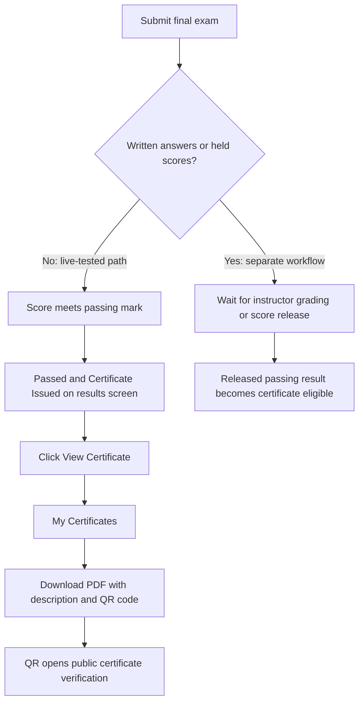

# Live final-examination flow check — October 19, 2026

Tested https://cpace-three.vercel.app using Chrome automation, a temporary learner,
and a ten-question objective final examination. The exam's passing score was
70%; the learner answered seven questions correctly and three incorrectly.
Scores were configured for immediate release.

## Confirmed learner flow

The result screen stays on the assessment page until the learner clicks
**View Certificate**. The button navigates to `/dashboard/certificates`.
Passing does not automatically redirect the learner to that page.

The immediate-release passing path issues the certificate automatically.
It does not enter an administrator approval or print-request queue.

## Live results

| Check | Observed result |
| --- | --- |
| Login | Normal credentials login authenticated the temporary learner |
| Pre-exam checks | Synthetic camera, captured test images, calibration and consent accepted |
| Exam start | A server-timed final-exam session was created |
| Answers | Seven of ten questions answered correctly through the live exam UI |
| Passing boundary | Exactly 70% was accepted against a 70% passing mark |
| Results screen | Displayed 70.0%, Passed!, and Certificate Issued! |
| Stored result | Finalized passing result saved; session changed to SUBMITTED |
| Enrollment | Changed to COMPLETED with progress 100% |
| Duplicate confirmation | Returned the same result; one attempt and one certificate remained |
| Certificates page | View Certificate opened My Certificates and displayed the earned certificate |
| Notifications | Assessment Passed and Certificate Issued notifications recorded |
| Learner reports | Displayed the released 70% passing result |
| PDF download | HTTP 200; valid PDF, 80,058 bytes, one page |
| PDF content | Test learner name, course, certificate number and description present |
| Embedded QR | Decoded from the PDF and matched the public verification URL |
| Public verification | Displayed VERIFIED CREDENTIAL and Valid Certification with its description |
| Cleanup | Temporary users, course, exam, session, answers, result, certificate and notifications removed |
| Verification after cleanup | Deleted test certificate no longer verifies |

The successful run completed at approximately **01:12:57 Asia/Singapore** on
October 19, 2026. The evidence uses a clearly labeled test course and synthetic
learner. No real learner's account, attempt or grade was changed.

## Conditions and finding

For written questions, the learner first sees that submission succeeded and
written answers await instructor grading. For held scores, the learner waits for
score release. Certificate eligibility depends on a released passing final
result; the learner certificate-list endpoint also issues missing eligible
certificates when that page is opened. These branches were inspected in source;
31 focused automated route tests for grading and exam timing also passed. The
live browser journey above exercised the immediate-release objective branch.

One display issue was observed: the PDF printed **October 18, 2026** as its issue
date, while My Certificates displayed **October 19, 2026** for the same issuance.
The issuance occurred on October 18 UTC / October 19 Asia/Singapore. The PDF
formats its date on the server without an explicit time zone, whereas the learner
page formats it in the browser. Use a consistent Philippine business time zone
when correcting this date discrepancy. It did not block the passing or
certificate flow. Application code was not changed during this check.

The browser used Chromium's synthetic camera device. Motion detection was
disabled on this isolated exam. This test does not establish real-person
identity verification, motion-detection accuracy, or concurrent camera capacity.

## Evidence

- [Passed result screen](../.local/stress-test/e2e-flow-31b08d33-29e9-4833-825b-1c1edcec45fb/01-passed-result.png)
- [My Certificates screen](../.local/stress-test/e2e-flow-31b08d33-29e9-4833-825b-1c1edcec45fb/02-my-certificates.png)
- [Downloaded test PDF](../.local/stress-test/e2e-flow-31b08d33-29e9-4833-825b-1c1edcec45fb/test-certificate.pdf)
- [Rendered PDF preview](../.local/stress-test/e2e-flow-31b08d33-29e9-4833-825b-1c1edcec45fb/03-certificate-preview.png)
- [Journey report](../.local/stress-test/e2e-flow-31b08d33-29e9-4833-825b-1c1edcec45fb/report.json)
- [PDF and QR checks](../.local/stress-test/e2e-flow-31b08d33-29e9-4833-825b-1c1edcec45fb/pdf-evidence.json)

The test certificate was deleted during cleanup. Its QR URL now shows the
not-found state; the saved report records the successful verification before
cleanup. Local evidence is Git-ignored. The repeatable journey is implemented in
`scripts/check-final-exam-flow.mjs`; running it sends a real authenticated test
journey to the live website and creates and removes isolated test fixtures.
